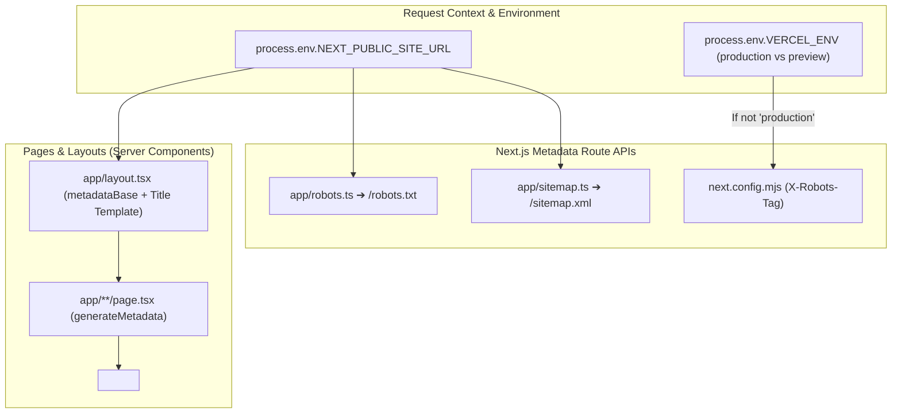

# Next.js 15 SEO, Metadata & Structured Data (Schema.org)

This skill provides architectural standards, code templates, and validation procedures for implementing **modern technical and semantic SEO** in Next.js 15+ applications.

---

## 1. Architectural Philosophy: Semantic & Environment-Aware SEO

Modern SEO requires three synchronized pillars:
1. **Crawl & Discovery:** Machine-readable routes (`robots.ts`, `sitemap.ts`) and environment gates (preventing staging/preview environments from being indexed by Google).
2. **Social & Sharing Graph:** OpenGraph, Twitter Cards, and canonical URLs anchored by an absolute `metadataBase`.
3. **Structured Semantic Data (Schema.org / JSON-LD):** Giving search engines machine-readable understanding of business entities, authors, articles, and breadcrumbs (critical for Google E-E-A-T and rich search snippets).



---

## 2. Environment Indexing Control (`next.config.mjs`)

Never manually toggle `noindex` before releases. Automate indexing based on Vercel's native environment variables:

```javascript
// next.config.mjs
/** @type {import('next').NextConfig} */
const nextConfig = {
  async headers() {
    // 🔒 Block search crawlers on Preview & Staging (*.vercel.app)
    // 🌐 Automatically allow indexing on Production domain
    if (process.env.VERCEL_ENV !== 'production') {
      return [
        {
          source: '/:path*',
          headers: [
            {
              key: 'X-Robots-Tag',
              value: 'noindex, nofollow',
            },
          ],
        },
      ];
    }
    return [];
  },
};

export default nextConfig;
```

---

## 3. Dynamic Metadata Routes

### 3.1. `src/app/robots.ts`
```typescript
import type { MetadataRoute } from 'next';

export default function robots(): MetadataRoute.Robots {
  const baseUrl = process.env.NEXT_PUBLIC_SITE_URL || 'https://yourdomain.com';

  return {
    rules: {
      userAgent: '*',
      allow: '/',
      disallow: ['/cabinet', '/cabinet/*', '/api/*', '/studio/*'],
    },
    sitemap: `${baseUrl}/sitemap.xml`,
  };
}
```

### 3.2. `src/app/sitemap.ts` (Dynamic Multi-Entity Sitemap)
```typescript
import type { MetadataRoute } from 'next';

export const revalidate = 3600; // Regenerate sitemap at most once per hour

export default async function sitemap(): Promise<MetadataRoute.Sitemap> {
  const baseUrl = process.env.NEXT_PUBLIC_SITE_URL || 'https://yourdomain.com';

  // 1. Static Hub Pages
  const staticRoutes: MetadataRoute.Sitemap = [
    { url: `${baseUrl}`, lastModified: new Date(), changeFrequency: 'daily', priority: 1.0 },
    { url: `${baseUrl}/services`, lastModified: new Date(), changeFrequency: 'weekly', priority: 0.9 },
    { url: `${baseUrl}/about`, lastModified: new Date(), changeFrequency: 'monthly', priority: 0.8 },
    { url: `${baseUrl}/blog`, lastModified: new Date(), changeFrequency: 'weekly', priority: 0.8 },
    { url: `${baseUrl}/contact`, lastModified: new Date(), changeFrequency: 'monthly', priority: 0.7 },
  ];

  // 2. Fetch dynamic slugs from CMS or Database
  // const posts = await getPublishedPosts();
  // const dynamicRoutes = posts.map(post => ({
  //   url: `${baseUrl}/blog/${post.slug}`,
  //   lastModified: new Date(post.updatedAt),
  //   changeFrequency: 'monthly',
  //   priority: 0.7,
  // }));

  return [...staticRoutes];
}
```

---

## 4. Root Layout & MetadataBase

In Next.js 15, omitting `metadataBase` results in build warnings and broken OpenGraph images.

```typescript
// src/app/layout.tsx
import type { Metadata } from 'next';
import { Inter, Plus_Jakarta_Sans } from 'next/font/google';

const inter = Inter({ subsets: ['latin', 'cyrillic'], variable: '--font-inter', display: 'swap' });
const plusJakarta = Plus_Jakarta_Sans({ subsets: ['latin'], variable: '--font-heading', display: 'swap' });

export const metadata: Metadata = {
  metadataBase: new URL(process.env.NEXT_PUBLIC_SITE_URL || 'https://yourdomain.com'),
  title: {
    default: 'Brand Name — Primary Service & Value Proposition',
    template: '%s | Brand Name',
  },
  description: 'Authoritative description optimized for Google search snippets (150-160 characters).',
  openGraph: {
    siteName: 'Brand Name',
    locale: 'uk_UA',
    type: 'website',
  },
  twitter: {
    card: 'summary_large_image',
  },
};

export default function RootLayout({ children }: { children: React.ReactNode }) {
  return (
    <html lang="uk" className={`${inter.variable} ${plusJakarta.variable}`}>
      <body>{children}</body>
    </html>
  );
}
```

---

## 5. Schema.org Structured Data (JSON-LD)

Structured data must be injected via `<script type="application/ld+json">` in Server Components.

### 5.1. Organization / Business Entity Schema
```typescript
// src/lib/seo/schema.ts

export function generateOrganizationJsonLd() {
  const baseUrl = process.env.NEXT_PUBLIC_SITE_URL || 'https://yourdomain.com';

  return {
    '@context': 'https://schema.org',
    '@type': 'LocalBusiness', // Or 'MedicalClinic', 'Store', 'Corporation'
    name: 'Brand Name',
    url: baseUrl,
    telephone: '+380501234567',
    address: {
      '@type': 'PostalAddress',
      streetAddress: 'вул. Прикладівська, 10',
      addressLocality: 'Київ',
      postalCode: '01001',
      addressCountry: 'UA',
    },
    geo: {
      '@type': 'GeoCoordinates',
      latitude: 50.4501,
      longitude: 30.5234,
    },
    openingHoursSpecification: [
      {
        '@type': 'OpeningHoursSpecification',
        dayOfWeek: ['Monday', 'Tuesday', 'Wednesday', 'Thursday', 'Friday'],
        opens: '09:00',
        closes: '19:00',
      },
    ],
  };
}
```

### 5.2. BreadcrumbList Schema (Crucial for Site Hierarchy)
```typescript
export function generateBreadcrumbJsonLd(items: Array<{ name: string; url: string }>) {
  return {
    '@context': 'https://schema.org',
    '@type': 'BreadcrumbList',
    itemListElement: items.map((item, index) => ({
      '@type': 'ListItem',
      position: index + 1,
      name: item.name,
      item: item.url,
    })),
  };
}
```

### 5.3. Injecting into a Server Component
```tsx
// src/app/(site)/services/[slug]/page.tsx
import { generateBreadcrumbJsonLd } from '@/lib/seo/schema';

export default async function ServicePage({ params }: { params: { slug: string } }) {
  const breadcrumbData = generateBreadcrumbJsonLd([
    { name: 'Головна', url: 'https://yourdomain.com' },
    { name: 'Послуги', url: 'https://yourdomain.com/services' },
    { name: 'Консультація', url: `https://yourdomain.com/services/${params.slug}` },
  ]);

  return (
    <>
      <script
        type="application/ld+json"
        dangerouslySetInnerHTML={{ __html: JSON.stringify(breadcrumbData) }}
      />
      <main>...</main>
    </>
  );
}
```

---

## 6. Core Web Vitals Optimization Checklist

- [ ] **Next.js Font Optimization:** Never use raw `<link rel="stylesheet">` for Google Fonts in `<head>`. Always use `next/font/google` to eliminate layout shifts (CLS = 0) and avoid blocking render threads.
- [ ] **Next.js Image CDN:** Replace all standard `` tags with `next/image` (`<Image />`) to ensure automatic WebP/AVIF compression, lazy-loading, and responsive `sizes`.
- [ ] **Server Container Boundary:** Keep all `page.tsx` files as pure Server Components to allow parallel streaming and static metadata compilation.
- [ ] **Rich Results Test:** Validate generated schemas via Google's [Rich Results Test](https://search.google.com/test/rich-results) before launching to production.
