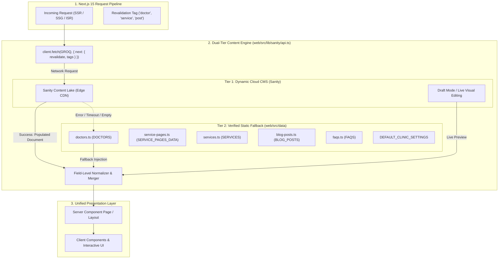
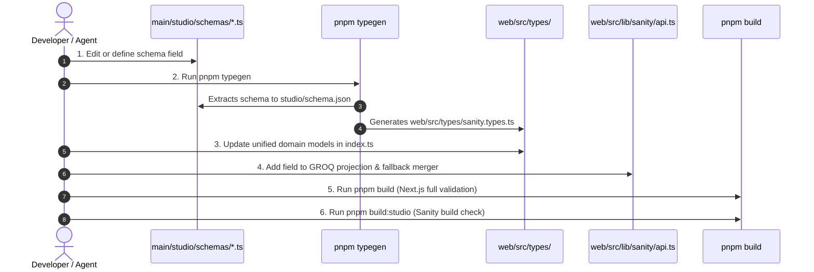

# Headless CMS Architecture: Schemas, Field-Level Fallbacks & Static Resilience

This skill provides architectural standards, production-grade patterns, and implementation guides for building a **resilient dual-tier content engine** pairing a headless CMS (Sanity Studio v3) with Next.js 15+ (App Router). It establishes how to achieve zero-downtime, zero-500s content delivery with field-level fallback resolution and strict schema synchronization.

---

## 1. Architectural Philosophy: The Dual-Tier Resilient Content Engine

Modern enterprise web applications cannot afford to couple front-end availability directly to third-party CMS network latency, quota exhausts, cold starts, or unfinished content drafts.

To guarantee **100% uptime, fast First Contentful Paint (FCP), and zero visual layout shifts**, the system decouples content into two complementary tiers:



### Core Invariants

1. **Sanity Cloud is the Authoritative Content Source:** When an editor publishes or updates a document in Sanity Studio, it immediately becomes the primary source of truth across the site.
2. **Static Data is the Immutable Operational Floor:** Files in `main/web/src/data/*.ts` contain clinically verified, curated copy. If the Sanity API is unreachable, misconfigured, or experiencing cold starts, the application serves 100% functional static pages without failing builds or throwing 500 errors.
3. **Field-Level (Granular) Resolution:** Fallbacks do not merely operate at the document level. If an editor creates a new record in Sanity Studio but leaves non-mandatory fields unpopulated (e.g. creating a doctor profile with only a name and photo), the application gracefully populates missing fields from static backups, preventing broken layouts, blank tabs, and missing sections.
4. **Clean Monorepo & Environment Separation:** Sanity Studio code (`main/studio/`) and Next.js web application code (`main/web/`) are completely decoupled packages with separate `tsconfig.json`, dependencies, and environment scopes.

---

## 2. Monorepo Structure & Environment Scopes

The codebase maintains strict isolation between the editorial studio and consumer web application:

```
dimimunitetu/
├── main/
│   ├── studio/                     # dimimunitetu-studio (Vite + Sanity v3)
│   │   ├── schemas/                # Document & Object schema definitions
│   │   │   ├── clinicSettings.ts   # Global clinic parameters (contacts, schedule, MOH license)
│   │   │   ├── doctor.ts           # Doctor profiles, education, certificates, conferences
│   │   │   ├── faqItem.ts          # Homepage global FAQs
│   │   │   ├── medicalDirection.ts # Clinical directions, embedded SEO, symptoms, methods
│   │   │   ├── pageSeo.ts          # Static hub route SEO metadata
│   │   │   ├── post.ts             # Medical blog articles (Portable Text)
│   │   │   ├── service.ts          # Services & package deals
│   │   │   └── index.ts            # Registered schemaTypes
│   │   ├── sanity.config.ts        # Studio plugins, structure tool, presentation tool
│   │   └── .env                    # SANITY_STUDIO_* variables only
│   │
│   └── web/                        # dimimunitetu-web (Next.js 15 App Router)
│       ├── src/
│       │   ├── data/               # Verified static fallback datasets
│       │   │   ├── blog-posts.ts   # Static articles & author associations
│       │   │   ├── doctors.ts      # 7 comprehensive doctor profiles
│       │   │   ├── faqs.ts         # Verified FAQ questions & answers
│       │   │   ├── service-pages.ts# 7 medical direction deep-dives & symptoms
│       │   │   └── services.ts     # Complete pricing catalog & packages
│       │   ├── lib/sanity/
│       │   │   ├── client.ts       # Configured next-sanity client
│       │   │   └── api.ts          # Central fallback resolver & GROQ queries
│       │   └── types/
│       │       ├── index.ts        # Unified frontend domain interfaces
│       │       └── sanity.types.ts # Auto-generated TypeScript definitions
│       └── .env                    # NEXT_PUBLIC_* and server-side secrets
```

### Environment Isolation Rules

| Variable | Scope | Location | Purpose |
| :--- | :---: | :--- | :--- |
| `SANITY_STUDIO_PROJECT_ID` | Studio Client | `main/studio/.env` | Vite bundle configuration |
| `SANITY_STUDIO_DATASET` | Studio Client | `main/studio/.env` | Dataset target (`production`) |
| `SANITY_STUDIO_PREVIEW_URL` | Studio Client | `main/studio/.env` | Target URL for iframe Visual Editing |
| `NEXT_PUBLIC_SANITY_PROJECT_ID` | Web Public | `main/web/.env` | Client-side and server-side fetch |
| `NEXT_PUBLIC_SANITY_DATASET` | Web Public | `main/web/.env` | Target dataset (`production`) |
| `SANITY_API_READ_TOKEN` | Web Server Only | `main/web/.env` | Draft mode & preview bypass (Never expose to browser) |

---

## 3. The Central Resolver Engine (`web/src/lib/sanity/api.ts`)

All communication between Next.js and Sanity flows through centralized getter functions in `web/src/lib/sanity/api.ts`. Direct `client.fetch` calls inside UI components are strictly prohibited.

### Architecture of a Production Resolver Function

Every getter implements:
1. **ISR Cache Tagging:** Next.js cache revalidation tags (`tags: ['doctor']`) for on-demand purge via webhooks.
2. **Defensive GROQ Projections:** Dereferencing relations inline (e.g. `assignedDoctor->slug.current`, `photo.asset->url`).
3. **Empty Collection Protection:** Falling back immediately if Sanity returns an empty array `[]`.
4. **Field-Level Fallback Normalization:** Merging live values over static fallbacks.
5. **Catch-Block Circuit Breaker:** Returning static data if network requests timeout or fail.

```typescript
// Pattern: Complete Resilient Resolver Function
export async function getDoctors(): Promise<Doctor[]> {
  try {
    const sanityDoctors = await client.fetch<any[]>(
      `*[_type == "doctor"] | order(coalesce(order, 999) asc) {
        _id,
        name,
        "slug": slug.current,
        title,
        "photoUrl": photo.asset->url,
        quote,
        experience,
        specialization,
        "specializations": *[_type == "medicalDirection" && references(^._id)].title,
        bio,
        membership,
        conferences,
        patients,
        education[] { institution, detail },
        schedule[] { day, hours, isOff },
        "certificates": certificates[] {
          title,
          issuer,
          year,
          "imageUrl": asset->url,
          category
        },
        houseCallAvailable,
        houseCallPrice,
        order
      }`,
      {},
      {
        next: {
          revalidate: process.env.NODE_ENV === 'development' ? 0 : 60,
          tags: ['doctor'],
        },
      }
    );

    // Circuit Breaker: Fallback if Sanity returns zero documents
    if (!sanityDoctors || sanityDoctors.length === 0) {
      return DOCTORS;
    }

    // Field-Level Merging against static verified dataset
    return sanityDoctors.map((doc) => {
      const fallback = DOCTORS.find((d) => d.slug === (doc.slug || doc._id));
      
      return {
        id: doc.slug || doc._id,
        name: doc.name || fallback?.name || 'Без імені',
        slug: doc.slug || doc._id,
        title: doc.title || fallback?.title || 'Лікарка клініки',
        specialty: doc.specialization || fallback?.specialty || doc.title || 'Доказова медицина',
        specialization: doc.specialization || fallback?.specialization || doc.title || 'Консультації',
        // Anti-Blank-UI Array Pattern:
        bio: (Array.isArray(doc.bio) && doc.bio.length > 0)
          ? doc.bio
          : (fallback?.bio || ['Доказова спеціалістка клініки «Дім Імунітету»']),
        education: (Array.isArray(doc.education) && doc.education.length > 0)
          ? doc.education
          : (fallback?.education || []),
        membership: (Array.isArray(doc.membership) && doc.membership.length > 0)
          ? doc.membership
          : (fallback?.membership || []),
        conferences: (Array.isArray(doc.conferences) && doc.conferences.length > 0)
          ? doc.conferences
          : (fallback?.conferences || []),
        schedule: (Array.isArray(doc.schedule) && doc.schedule.length > 0)
          ? doc.schedule
          : (fallback?.schedule || []),
        certificates: (Array.isArray(doc.certificates) && doc.certificates.length > 0)
          ? doc.certificates
          : (fallback?.certificates || []),
        houseCallAvailable: doc.houseCallAvailable !== undefined
          ? Boolean(doc.houseCallAvailable)
          : Boolean(fallback?.houseCallAvailable),
        order: typeof doc.order === 'number' ? doc.order : undefined,
      };
    });
  } catch (error) {
    console.error('Error fetching doctors from Sanity, falling back to static:', error);
    return DOCTORS; // Emergency zero-downtime floor
  }
}
```

---

## 4. Field-Level Fallback Resolution Patterns

### 4.1. Scalar Strings & Numbers
Use standard short-circuit evaluation, ensuring empty strings `""` fall back properly:
```typescript
name: doc.name?.trim() || fallback?.name || 'Без імені',
price: typeof doc.price === 'number' ? doc.price : (fallback?.price || 0),
```

### 4.2. Arrays & Structured Objects (The "Anti-Blank-UI" Rule)
> [!CAUTION]
> **The `doc.array || fallback.array` Trap:**  
> In Sanity, when an editor creates a record or touches an array field without adding items, Sanity serializes it as `[]`. In JavaScript, `[] || fallback` evaluates to `[]` because empty arrays are truthy!  
> As a result, the UI receives an empty list, hiding the component or rendering an empty card.

**Correct Production Pattern:** Always inspect array length:
```typescript
// CORRECT: Verifies array contains elements before suppressing fallback
education: (Array.isArray(doc.education) && doc.education.length > 0)
  ? doc.education
  : (fallback?.education || [])
```

### 4.3. Rich Text (Portable Text) to Structured UI Sections
Articles in Sanity use Portable Text (`body: array of block`), while static fallbacks or simplified UI views use structured section models. The resolver dynamically parses Portable Text into structured sections:

```typescript
// Inside getBlogPostBySlug() in api.ts:
if (Array.isArray(post.body)) {
  for (const block of post.body) {
    if (block._type === 'block' && Array.isArray(block.children)) {
      const text = block.children.map((c: any) => c.text || '').join('').trim();
      if (!text) continue;

      if (block.style === 'h2' || block.style === 'h3') {
        if (currentSection.text.length > 0) sections.push(currentSection);
        currentSection = { heading: text, text: [] };
      } else {
        currentSection.text.push(text);
      }
    }
  }
}
```

### 4.4. Staged Content Migration (Collection Union Strategy)
During staged migration to Sanity, editors might only have published 2 out of 10 articles. Returning only Sanity records would delete 8 articles from the catalog.

The resolver employs a **Union by Unique Identifier** strategy:
```typescript
// Sanity posts take precedence; static posts with non-colliding slugs are appended
const sanitySlugs = new Set(mappedSanityPosts.map((p) => p.slug));
const remainingStatic = BLOG_POSTS.filter((p) => !sanitySlugs.has(p.slug));

return [...mappedSanityPosts, ...remainingStatic];
```

### 4.5. The In-Component Shadowing Trap & Single Normalization Boundary
> [!CAUTION]
> **The In-Component Fallback Anti-Pattern:**  
> Never declare static fallback datasets (e.g. `const CLINICAL_DIRECTIONS = [...]`, `const diagnosticsMap = {...}`) inside UI presentation components.  
> When a UI component performs in-line fallback merging (`prop.value || localFallback.value`), upstream dynamic objects that pass an unmigrated, empty, or differently-purposed field (such as a page hero subtitle instead of a teaser card description) will silently shadow the local fallback, causing fresh code updates to be hidden behind stale upstream data.
>
> **Enforced Architecture (Single Normalization Boundary):**  
> 1. **Single Source of Truth:** All static fallback data must reside strictly in `web/src/data/*.ts`.
> 2. **Single Boundary:** 100% of field-level merging and fallback resolution occurs exclusively in the Data Access Layer (`web/src/lib/sanity/api.ts`).
> 3. **Pure Presentation Components:** UI components must receive normalized, render-ready props and must NEVER duplicate or compete with data-layer fallbacks.
> 4. **Field Semantic Separation:** Distinct visual contexts must use distinct fields. Do not overload `subtitle` to represent both a landing page hero subhead and a homepage teaser card description; explicitly define `cardDescription` (or `teaserDescription`) vs `heroSubtitle`.
>
> *For the complete architectural decision record, context, options considered, and trade-offs, see [ADR 0007 Reference](./references/adr-0007-anti-shadowing.md).*
>
> **Reference Implementations & Tooling:**
> - Canonical Resolver: [`examples/canonical-api-resolver.ts`](./examples/canonical-api-resolver.ts)
> - Pure Presentation Component: [`examples/pure-presentation-component.tsx`](./examples/pure-presentation-component.tsx)
> - Runtime Contract Test: [`examples/contract-test-template.mjs`](./examples/contract-test-template.mjs)
> - Automated ADR 0007 Auditor: Run `node <skill_dir>/scripts/validate-dual-tier-contracts.mjs` to detect in-component fallback shadowing across any project.

---

## 5. Domain Matrix & Schema Entity Mapping

| Domain Model | Sanity Schema | Fallback Dataset | UI Consumers | Core Fields Covered |
| :--- | :--- | :--- | :--- | :--- |
| **Doctor** | `studio/schemas/doctor.ts` | `web/src/data/doctors.ts` | `/doctors`, `/doctors/[slug]`, Direction cards, Hero | `name`, `slug`, `title`, `specialization`, `quote`, `bio`, `education`, `membership`, `conferences`, `schedule`, `certificates`, `houseCallAvailable` |
| **Medical Direction** | `studio/schemas/medicalDirection.ts` | `web/src/data/service-pages.ts` | `/services/[slug]`, Header menu, Homepage grid | `title`, `slug`, `subtitle`, `cardDescription`, `heroProblem`, `categoryBadge`, `methods`, `specialists`, `services`, `packages`, `bookingService`, `faqs`, `reviews`, `crossLinks`, `seo` |
| **Service & Package** | `studio/schemas/service.ts` | `web/src/data/services.ts` | `/services`, Prices tables, `PackageCard`, Booking Modal | `name`, `slug`, `category`, `price`, `duration`, `description`, `features`, `badge`, `forWhom`, `assignedDoctor`, `order` |
| **Blog Post** | `studio/schemas/post.ts` | `web/src/data/blog-posts.ts` | `/blog`, `/blog/[slug]`, Homepage highlights | `title`, `slug`, `author`, `category`, `mainImage`, `excerpt`, `publishedAt`, `readTime`, `body`, `seo` |
| **Homepage FAQ** | `studio/schemas/faqItem.ts` | `web/src/data/faqs.ts` | Homepage FAQ Accordion | `question`, `answer`, `category`, `order` |
| **Clinic / Brand Settings** | `studio/schemas/clinicSettings.ts` | `DEFAULT_CLINIC_SETTINGS` | Footer, Header, Booking contacts, Schema.org | `clinicName`, `phone`, `email`, `address`, `workingHours`, `license`, `socialLinks`, `alertBanner` |
| **Hub Route SEO** | `studio/schemas/pageSeo.ts` | Inline route metadata | `/`, `/services`, `/doctors`, `/blog`, `/prices`, `/cabinet` | `metaTitle`, `metaDescription`, `keywords`, `ogImage`, `canonicalUrl`, `noIndex` |

---

## 6. Architectural Governance & Best Practices

### 6.1. Decoupled SEO: Embedded Direction SEO vs Route `pageSeo`
- **The Rule:** Do NOT add `/services/[slug]` routes into `pageSeo.ts`.
- **The Architecture:**
  - `pageSeo` manages exclusively static hub routes (`/`, `/services`, `/doctors`, etc.).
  - `medicalDirection.seo` is an embedded object inside each clinical direction document. This enforces **Single Source of Truth** — clinical SEO lives alongside symptoms, methods, and specialists.
  - Direction pages (`/services/[slug]/page.tsx`) query `getMedicalDirectionBySlug` directly, bypassing `pageSeo` and eliminating redundant API round-trips.

### 6.2. Strict Separation of Styling from CMS Content
- **The Rule:** Never expose CSS utility classes, hex color codes, or layout boolean flags (`highlight`, `isCardBorderGreen`) in Sanity schemas.
- **The Architecture:**
  - Editors enter semantic information: `badge: "Популярний пакет"`.
  - Frontend components compute visual styles deterministically:
    ```typescript
    // In PackageCard.tsx:
    const isHighlighted = Boolean(item.badge || item.highlight);
    const borderClass = isHighlighted ? 'border-border-whisper hover:border-emerald-300 shadow-xs' : 'border-border-whisper';
    ```

### 6.3. Unified Service Model (Eliminate Orphan Schemas)
- All clinical offerings — whether standalone consultations, diagnostic tests, or multi-week packages — share the `service.ts` schema.
- Packages are designated by `category: 'packages'` and utilize `features: string[]` for bullet points.
- Do not create independent `packageDeal` schemas.

### 6.4. Canonical Taxonomy Synchronization
All 7 clinical directions must be strictly synchronized across schemas, types, and navigation menus:
1. `endocrinology` (Ендокринологія та імунітет)
2. `psychiatry` (Психотерапія та психіатрія)
3. `therapy` (Терапія та ревматологія)
4. `immunology` (Клінічна імунологія)
5. `allergology` (Алергологія та АСІТ)
6. `vaccination` (Вакцинація)
7. `nutrition` (Нутриціологія та харчування)

Whenever a medical direction is added or modified, update:
- Options list in `main/studio/schemas/service.ts`
- Options list in `main/studio/schemas/post.ts`
- Options list in `main/studio/schemas/faqItem.ts`
- Type union `MedicalDirectionSlug` in `main/web/src/types/index.ts`
- Nav menu builder in `main/web/src/components/Header.tsx` & `Footer.tsx`

---

## 7. Developer Workflow: Type Generation & Schema Updates

Follow this exact sequential workflow whenever modifying or creating schemas:



### Command Reference

Run all commands from the `main/` workspace root:

```bash
# 1. Regenerate TypeScript types from Sanity schemas:
pnpm typegen

# 2. Canonical Validation Gate (Must pass before every commit):
pnpm build

# 3. Sanity Studio Standalone Build Validation:
pnpm build:studio
```

---

## 8. Common Pitfalls & Troubleshooting Matrix

| Symptom / Error | Root Cause | Immediate Remediation |
| :--- | :--- | :--- |
| **Empty UI blocks (e.g. blank education list)** | Checking `doc.education \|\| fallback` when Sanity returns `[]` (truthy). | Check array length: `(Array.isArray(doc.field) && doc.field.length > 0) ? doc.field : fallback`. |
| **Edits in Studio do not reflect on live site** | Route is using ISR without cache tag revalidation or missing tag. | Verify `api.ts` includes proper tags: `tags: ['doctor']` and test `/api/revalidate?tag=doctor`. |
| **Missing direction in FAQ or Blog category dropdown** | New clinical category added to code but omitted from schema `options.list`. | Add `{ title: '...', value: 'slug' }` to `category` in `faqItem.ts` and `post.ts`. |
| **TypeScript error: `Property does not exist on type ServiceItem`** | Schema field added without updating `types/index.ts` domain interface. | Add optional property (e.g. `features?: string[]`) to `types/index.ts`. |
| **Redundant API calls on `/services/[slug]`** | Route querying `pageSeo` document in addition to `medicalDirection`. | Remove `pageSeo` query; use embedded `medicalDirection.seo` object. |
| **`pnpm build` fails after schema edit** | Schema change broke GROQ return type or missing import. | Re-run `pnpm typegen`, check `api.ts` field mappings, and verify build. |
