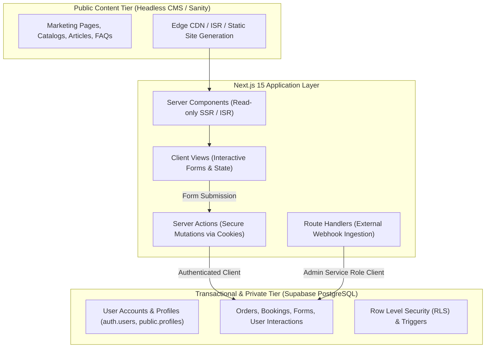
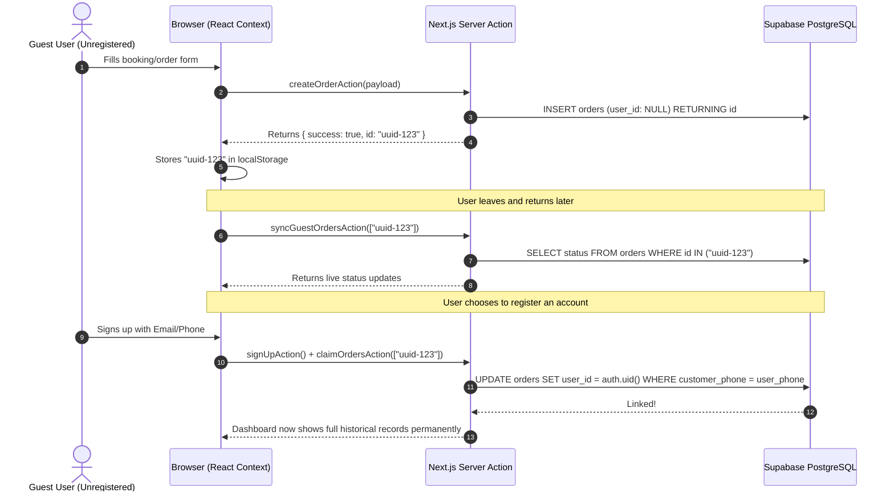

# Supabase Integration in Next.js 15 (App Router)

This skill provides architectural standards, production-grade patterns, and security best practices for integrating Supabase into Next.js 15+ applications, specifically within modern hybrid stacks (e.g., Sanity Headless CMS for public content + Supabase PostgreSQL for private/transactional data).

---

## 1. Architectural Philosophy: The Separation of Concerns

In modern web applications, decouple public content from private transactional state:



### Core Invariants:
1. **Public vs Private Isolation:** Never store marketing content or public copy in Supabase tables if a CMS is present. Supabase stores purely transactional, relational, and user-owned data.
2. **Defense-in-Depth RLS:** Never trust client-side claims or API parameters. Every table in Supabase MUST have Row Level Security enabled (`ALTER TABLE ... ENABLE ROW LEVEL SECURITY`).
3. **Async Cookies in Next.js 15:** In Next.js 15, `cookies()` returns a `Promise<ReadonlyRequestCookies>`. Supabase client factories must `await cookies()`.

---

## 2. Package Setup & Environment Variables

### Required Packages
```bash
pnpm add @supabase/supabase-js @supabase/ssr
```

### Environment Scopes
Keep public keys segregated from privileged secrets:
```env
# Exposed to browser bundle
NEXT_PUBLIC_SUPABASE_URL=https://<your-project-ref>.supabase.co
NEXT_PUBLIC_SUPABASE_ANON_KEY=eyJhbGciOi...

# Server-only (NEVER expose to browser bundle or prefix with NEXT_PUBLIC_)
SUPABASE_SERVICE_ROLE_KEY=eyJhbGciOi...
```

---

## 3. The Client Trinity Pattern

To ensure security and proper SSR token refresh in Next.js 15, implement three specialized client factories:

### 3.1. Server Client (for Server Components, Server Actions, and Route Handlers)
```typescript
// src/lib/supabase/server.ts
import { createServerClient } from '@supabase/ssr';
import { cookies } from 'next/headers';
import type { Database } from '@/types/database';

export async function createClient() {
  const cookieStore = await cookies();

  return createServerClient<Database>(
    process.env.NEXT_PUBLIC_SUPABASE_URL!,
    process.env.NEXT_PUBLIC_SUPABASE_ANON_KEY!,
    {
      cookies: {
        getAll() {
          return cookieStore.getAll();
        },
        setAll(cookiesToSet) {
          try {
            cookiesToSet.forEach(({ name, value, options }) =>
              cookieStore.set(name, value, options)
            );
          } catch {
            // Called from a Server Component; safe to ignore if middleware refreshes sessions
          }
        },
      },
    }
  );
}
```

### 3.2. Browser Client (Single-instance for Client Components & Auth Listeners)
```typescript
// src/lib/supabase/client.ts
import { createBrowserClient } from '@supabase/ssr';
import type { Database } from '@/types/database';

let client: ReturnType<typeof createBrowserClient<Database>> | undefined;

export function getBrowserClient() {
  if (!client) {
    client = createBrowserClient<Database>(
      process.env.NEXT_PUBLIC_SUPABASE_URL!,
      process.env.NEXT_PUBLIC_SUPABASE_ANON_KEY!
    );
  }
  return client;
}
```

### 3.3. Admin / Service Role Client (Bypasses RLS for trusted webhooks & background workers)
```typescript
// src/lib/supabase/admin.ts
import { createClient } from '@supabase/supabase-js';
import type { Database } from '@/types/database';

export function createAdminClient() {
  const url = process.env.NEXT_PUBLIC_SUPABASE_URL;
  const serviceKey = process.env.SUPABASE_SERVICE_ROLE_KEY;

  if (!url || !serviceKey) {
    throw new Error('Supabase Admin Service Role credentials missing from environment.');
  }

  return createClient<Database>(url, serviceKey, {
    auth: {
      persistSession: false,
      autoRefreshToken: false,
    },
  });
}
```

---

## 4. Row Level Security (RLS) Best Practices

### The Four Commandments of RLS:
1. **Enable RLS on every table:**
   ```sql
   ALTER TABLE public.profiles ENABLE ROW LEVEL SECURITY;
   ALTER TABLE public.orders ENABLE ROW LEVEL SECURITY;
   ```
2. **Default Deny:** If no policy matches, PostgreSQL rejects the query.
3. **Owner Isolation (`auth.uid()`):**
   ```sql
   -- Allow users to read only their own profile
   CREATE POLICY "Users can read own profile"
   ON public.profiles FOR SELECT
   TO authenticated
   USING (auth.uid() = id);

   -- Allow users to update only their own profile
   CREATE POLICY "Users can update own profile"
   ON public.profiles FOR UPDATE
   TO authenticated
   USING (auth.uid() = id)
   WITH CHECK (auth.uid() = id);
   ```
4. **Guest Submissions Pattern:**
   For public forms where unauthenticated users can submit entries (e.g. leads, guest bookings):
   ```sql
   -- Allow anonymous inserts with required fields
   CREATE POLICY "Anyone can create pending entries"
   ON public.orders FOR INSERT
   TO anon, authenticated
   WITH CHECK (
     customer_phone IS NOT NULL AND
     status = 'pending'
   );

   -- Block anonymous read/update/delete; status updates happen via admin client in webhooks
   ```

---

## 5. Next.js 15 Server Actions Mutation Pattern

Always perform mutations in Server Actions rather than custom API routes, taking advantage of `useActionState`, Zod validation, and automatic path revalidation:

```typescript
// src/actions/orders.ts
'use server';

import { z } from 'zod';
import { revalidatePath } from 'next/cache';
import { createClient } from '@/lib/supabase/server';

const OrderSchema = z.object({
  customerName: z.string().min(2, "Name too short"),
  customerPhone: z.string().regex(/^\+?[0-9]{10,14}$/, "Invalid phone format"),
  serviceId: z.string().min(1, "Service required"),
});

export async function createOrderAction(formData: unknown) {
  const parsed = OrderSchema.safeParse(formData);
  if (!parsed.success) {
    return { success: false, error: parsed.error.issues[0].message };
  }

  const supabase = await createClient();
  const { data: { user } } = await supabase.auth.getUser();

  const { data, error } = await supabase
    .from('orders')
    .insert({
      user_id: user?.id || null, // Associates with account if authenticated
      customer_name: parsed.data.customerName,
      customer_phone: parsed.data.customerPhone,
      service_id: parsed.data.serviceId,
      status: 'pending',
    })
    .select('id, created_at')
    .single();

  if (error) {
    console.error('[createOrderAction error]:', error);
    return { success: false, error: 'Failed to record entry. Please try again.' };
  }

  revalidatePath('/dashboard');
  return { success: true, data };
}
```

---

## 6. The Hybrid "Guest-to-User" State Pattern

Many consumer platforms must allow guests to complete actions before signing up. To prevent broken experiences:



### Event-Driven Window Sync (Zero-Polling Realtime UX)
Instead of continuous interval polling that exhausts free tiers, synchronize status when the user switches tabs back:
```typescript
// In root context or dashboard layout:
useEffect(() => {
  const handleSync = () => {
    if (document.visibilityState === 'visible') {
      revalidateLiveState();
    }
  };

  window.addEventListener('focus', handleSync);
  document.addEventListener('visibilitychange', handleSync);
  return () => {
    window.removeEventListener('focus', handleSync);
    document.removeEventListener('visibilitychange', handleSync);
  };
}, []);
```

---

## 7. Common Pitfalls & Anti-Patterns

| Anti-Pattern | Risk | Correct Practice |
| :--- | :--- | :--- |
| **Using Service Role in Browser** | Total database compromise | Keep `SUPABASE_SERVICE_ROLE_KEY` strictly in server files (`lib/supabase/admin.ts`). Never prefix with `NEXT_PUBLIC_`. |
| **Sync `cookies()` in Next 15** | Build errors (`cookies() should be awaited`) | Always `await cookies()` before passing to `createServerClient`. |
| **Continuous `setInterval` Polling** | Free tier API & CPU exhaustion | Use event-driven sync (`window.focus`, `visibilitychange`) + manual refresh button. |
| **Bypassing RLS for convenience** | Privacy leaks / HIPAA & GDPR violations | Write granular RLS policies. Only use Admin Client for server-to-server webhooks or system jobs. |
| **Relying on `getSession()` in Server Components** | Security vulnerability (spoofed session) | Always use `supabase.auth.getUser()` to authenticate requests server-side, as it validates the token against Supabase Auth servers. |
